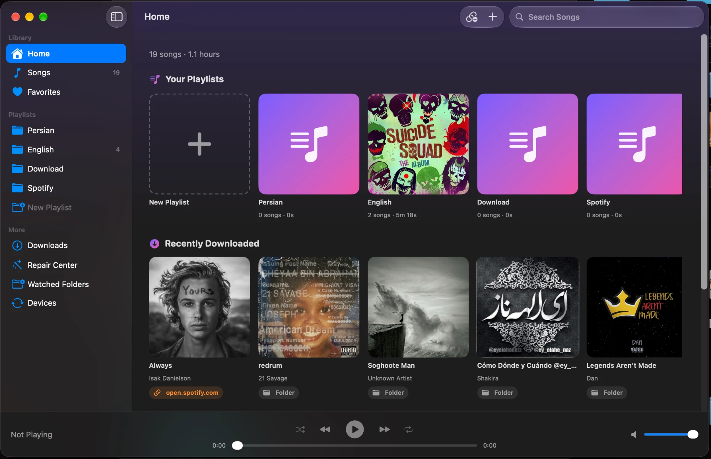
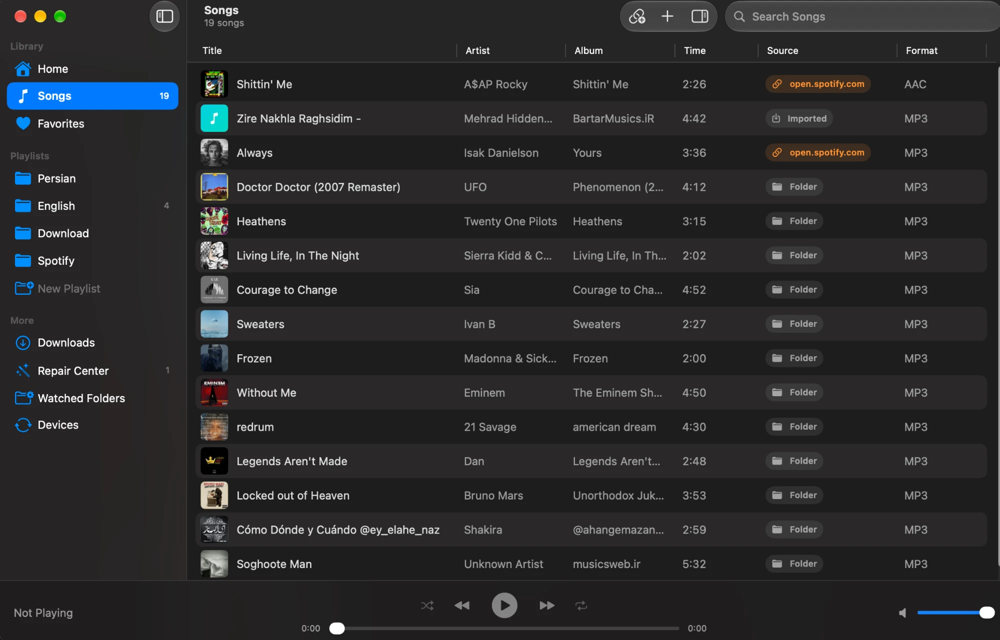
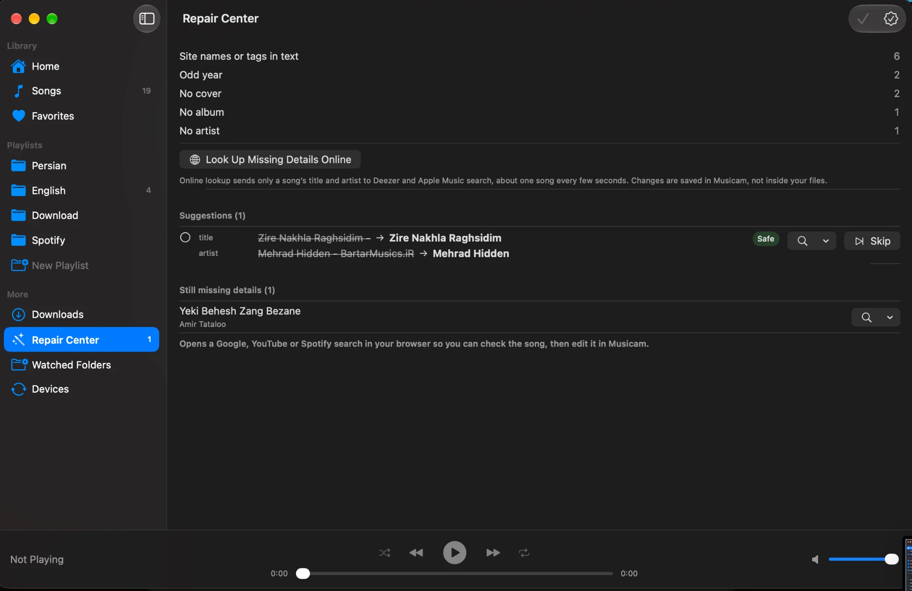
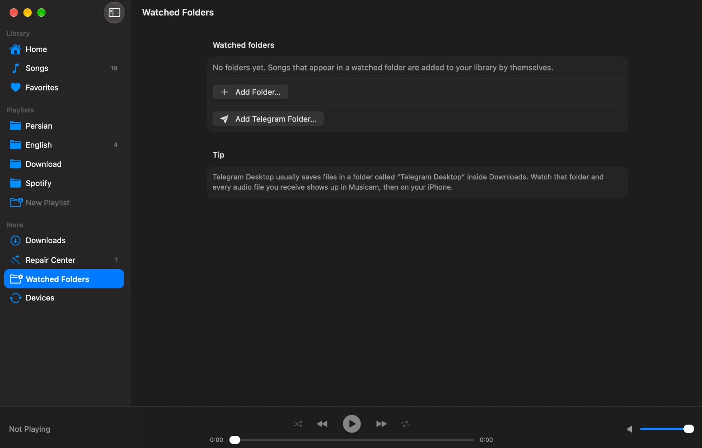
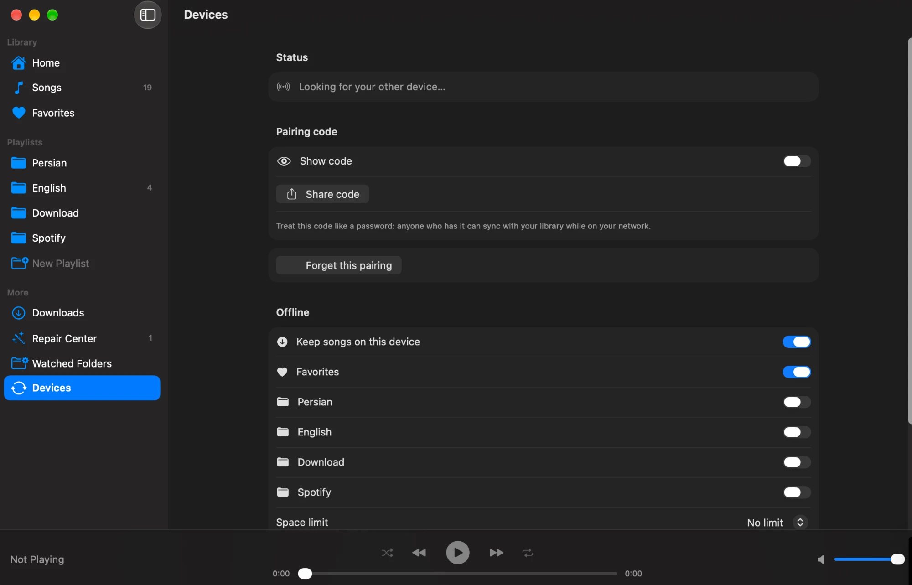
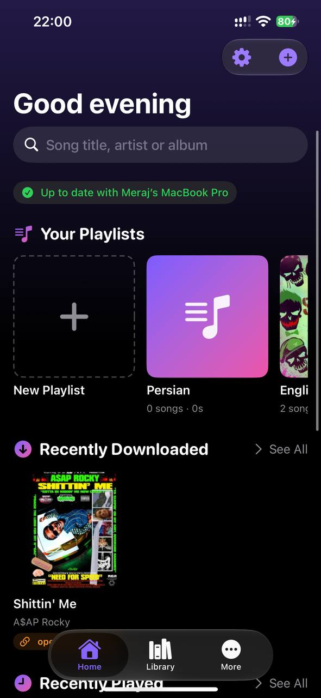
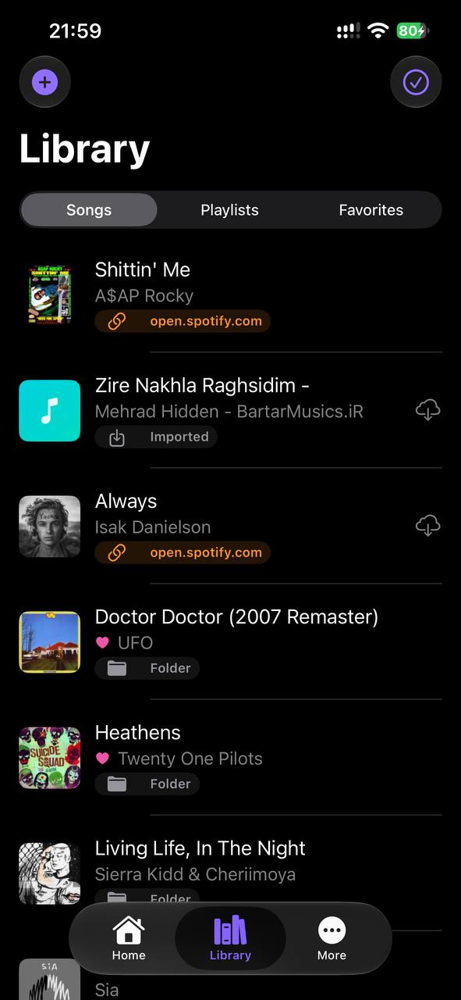
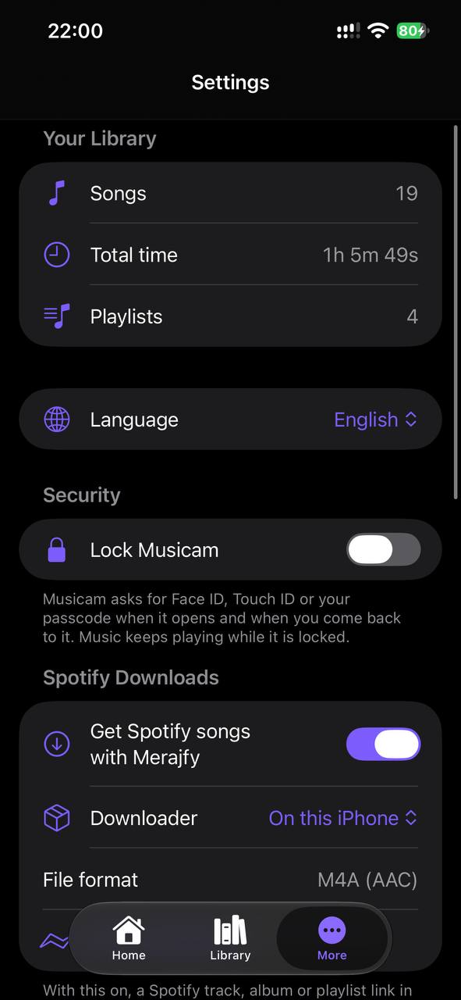

# Musicam (موزیکم)

Native macOS + iOS music library and player. Design: see the architecture document
(https://claude.ai/artifact/Pia1uKu8GDczt7Xe3XynM9). Sync is direct device-to-device, no iCloud.

## Screenshots

### macOS

<p>
  
  
</p>
<p>
  
  
  
</p>

### iPhone

<p>
  
  
  
</p>

## License

Musicam is released under the [MIT License](LICENSE). Copyright (c) 2026 Meraj Mirbazel.
Third-party components keep their own licenses (see "Third-party software" below).

## Legal disclaimer

- Musicam is provided for educational, research and software development purposes.
- Any download functionality should only be used for content that you own or that you are explicitly authorized to download.
- You are responsible for complying with the copyright laws that apply to you and with the terms of service of any third-party platform or service you use with this software.
- Musicam does not host or distribute third-party copyrighted content.
- Third-party tools and services (for example yt-dlp, ffmpeg and Python) retain their own licenses and terms.
- The project authors do not endorse copyright infringement or unauthorized downloading.
- This notice does not make any particular use of the software lawful. Whether a use is lawful depends on your jurisdiction, the content and the terms that apply, and it is your responsibility to check.

## Third-party software

- `Vendor/Python` contains a Python runtime for iOS (Python Software Foundation License), and the `yt-dlp` (Unlicense) and `certifi` (MPL-2.0) packages. Their license files are kept in place.
- The macOS app can embed `ffmpeg` and `yt-dlp` helper programs from a local `Helpers/` folder. That folder is not part of this repository. If you distribute a build that contains `ffmpeg`, follow the license of the `ffmpeg` build you embed (a build configured with `--enable-gpl` is under the GPL).

## Layout

| Path | What |
| --- | --- |
| `MusicamKit/` | Local Swift package: `Domain`, `Persistence` (SwiftData stores), `Importing`, `Playback`, `Sync` (change log, merge), `Features` (SwiftUI) |
| `App-macOS/`, `App-iOS/` | Thin app shells; every file in these folders is in the target automatically |
| `Config/` | Info.plist fragments and the Mac sandbox entitlements |
| `Musicam.xcodeproj` | Generated by `tools/gen_xcodeproj.py` (no third-party generator) |
| `tools/` | `gen_xcodeproj.py`, `make_icons.py` |

## Commands

```bash
cd MusicamKit && swift test                      # 63 tests: queue, sync merge, stores, import, playback, models, views
./scripts/build_mac_dmg.sh                       # Release build + dist/Musicam-<version>.dmg (ad-hoc signed)
python3 tools/gen_xcodeproj.py                   # regenerate the Xcode project
xcodebuild -project Musicam.xcodeproj -scheme Musicam-macOS -destination 'platform=macOS' CODE_SIGN_IDENTITY=- build
xcodebuild -project Musicam.xcodeproj -scheme Musicam-iOS -destination 'platform=iOS Simulator,name=iPhone 18 Pro' CODE_SIGNING_ALLOWED=NO build
```

## Decisions in force

macOS 15 / iOS 18 minimum (up to the latest); Mac app sandboxed; creator credit "by Meraj Mirbazel"; bundle ID `com.merajmirbazel.musicam`; Swift 6 language mode.
Signing: set your team in Xcode (Signing & Capabilities) to install on a real iPhone.

## Folder watching (0.3.0, macOS)

A sidebar item "Watched Folders" lets you choose folders (for example Telegram Desktop's download folder); audio that appears there is imported automatically and then syncs. Built on FSEvents (`Importing/FolderWatcher`), saved with security-scoped bookmarks (`DeviceStore`), coordinated by `Features/WatchedFolders`. Not tested: real Telegram Desktop folder, very large folders.

## Phase 2 status (0.2.0)

Device-to-device sync works between the Mac app and the iOS app (library records, live edits, audio files copied on demand, next song prefetched). Debug builds use the bundle ID `com.merajmirbazel.musicam.debug` so testing never touches the real library. Not done: Share Extension, background sync on iOS, real-iPhone and Wi-Fi speed tests, duplicate-merge across devices.

Debug-only pairing flags: Mac `-MusicamPair create` (writes the code to the container's tmp/pair-code.txt), iOS `-MusicamPairCode <code>`.

## Phase 1 status

macOS: import (drop, picker, folders), library browsing, playback, song editing. iOS: still the placeholder screen (Phase 2).
Debug builds only: launch arguments `-MusicamDemo YES -MusicamScreen songs|home|nowPlaying -MusicamSelect N -MusicamPlay YES -MusicamSnapshot <path>` make sample songs and save a picture of the window (see `App-macOS/DebugSupport.swift`).

## Repair Center (0.4.0, macOS)

Suggests fixes for song details and applies them only when you accept; every applied repair can be undone.

- Rules (offline): removes site names and quality tags (`[320]`, `www.site.com`, `(Official Audio)`), repairs garbled Persian/Arabic text saved in Windows-1256, normalizes Arabic ye/kaf to Persian, and takes artist/title from the file name when the title is generic or a file name.
- Online (optional, button): looks up songs missing artist or album on MusicBrainz by title and artist (about 1 request/s). It only fills blanks or fixes spelling of an artist that already matches; it never replaces a different artist.
- Duplicates: groups songs with the same normalized artist and title and nearly the same length; keeps the best copy (lossless, then bitrate, then more tags).
- Changes are saved in Musicam's library (and sync to other devices), not written into the audio files. Writing tags into files and audio fingerprinting need TagLib/Chromaprint, not added yet.
- Open items: MusicBrainz asks for a contact address in its User-Agent (TODO in `AppModel`); cover art: the online lookup also fetches a front cover from Cover Art Archive for songs without one (shown as a suggestion, undoable); the image itself is not yet sent to other devices, only its key.

## Playlists and collections (0.5.0; smart playlists and the built-in collections were removed in 0.10.0, only Favorites and hand-made playlists remain)

- Hand-made playlists (ordered, drag to reorder on Mac, Edit on iPhone) and smart lists defined by rules (`SmartRules`: title/artist/album/genre/year/rating/favorite/lossless/no cover/added recently, match all or any, sort, limit).
- Built-in collections: Favorites, Added This Month, Top Rated, Lossless, Without Cover.
- Playlists sync between devices like everything else (one journal entity; the song order is one field, so if two devices reorder at the same moment the later edit wins whole).
- Mac: sidebar sections Collections and Playlists, right-click songs > Add to Playlist. iPhone: new Playlists tab, touch and hold a song > Add to Playlist.
- Not built yet: a screen to create/edit smart-list rules (the engine and storage are done), play counts ("most played").

## iPhone: Share to Musicam and Repair (0.5.1)

- Share Sheet: in Telegram, Files, Safari downloads and so on, share an audio file and choose Musicam (it is registered as a handler for audio documents; `onOpenURL` copies the file into the app, imports it, and removes the temporary copy). Verified on the simulator by opening a `.wav` file URL. This is "Open in", not a separate Share Extension target; a real Share Extension would need an App Group and signing with an Apple ID, so it was left out on purpose.
- The original file name is kept when copying, because it is used as the title when a song has no tags (and the Repair Center turns `07_Kian_-_Night_Walk_[128]_[site.ir].mp3` into artist "Kian", title "Night Walk").
- Repair Center on iPhone: Library > the wand button (same suggestions, online lookup, duplicates, undo).

## Offline rules (0.6.0)

Per device (never synced): Devices > Offline > "Keep songs on this device". Choose Favorites, built-in collections (Added This Month, Top Rated, Lossless) and hand-made playlists, plus an optional space limit (2 to 20 GB).

- Whenever the other device is reachable, chosen songs that are missing are copied here one by one; progress shows in the section.
- With a limit, songs copied from the other device that are not chosen are removed oldest-first until the limit is met. Songs imported on this device (files outside the app's `Media` folder) are never removed, and without a limit nothing is ever removed.
- Verified end to end: sandboxed Mac debug app + iOS simulator, paired by code; with "-MusicamOffline YES" the simulator downloaded exactly the 3 favorites (not the other 7) with no tap. Eviction is covered by unit tests only.
- Debug note: builds with `CODE_SIGNING_ALLOWED=NO` are NOT sandboxed and write to `~/Library/Application Support/Musicam`; for Mac debug runs sign ad-hoc (`CODE_SIGN_IDENTITY=-`) so the sandbox container is used.

## Persian interface (0.7.0)

- The apps follow the device language: set the Mac or iPhone to Persian (or choose Persian for Musicam only in System Settings / Settings > Musicam > Language) and the interface, menus and messages are Persian, with right-to-left text. About 190 strings; the translations live in `tools/gen_strings.py` (run `python3 tools/gen_strings.py` after editing; it writes `Localizable.xcstrings` into both app folders).
- Verified: iPhone simulator in Persian (Home, Devices) and the Mac app in Persian (Songs, Repair Center) through the app's own snapshot. Not verified: every screen in Persian; the Mac window layout is not mirrored (sidebar stays on the left), only the text direction is; system buttons such as Paste follow the system language of the simulator.
- Bug found and fixed by this test: with a Persian device language `Calendar.current` is the Persian calendar (year 1405), so the "odd year" check built the invalid range 1900...1406 and the Repair Center crashed. It now uses the Gregorian calendar explicitly (regression test added).

## 0.9.0: MVP candidate

- **Smart playlist editor** (Mac: sidebar > New Smart Playlist…, right-click a smart playlist > Edit Rules…; iPhone: Playlists tab > + > New Smart Playlist…, touch and hold > Edit Rules…). Rules: title/artist/album contains, genre, year range, rating, favorite, lossless, no cover, added in the last N days; match all or any; sort; limit; live count of matching songs.
- **Duplicate merge across devices**: if both devices import the same file, after syncing they keep the oldest song, hide the other, carry over the best rating and favorite, and a device that holds the audio under the old file ID answers for the new one (tested with two stores; not yet seen on two real devices).
- **Add from Link** (Mac toolbar, iPhone Library > + menu, Wishlist screen):
  - Spotify and YouTube links are read only for their public title through the official oEmbed endpoints (verified live) and saved in the Wishlist (a local JSON file on this device, not synced). A wish is ticked off when a song with the same name appears in the library. (Changed after 0.11.0: with Merajfy turned on in Settings, a Spotify track, album or playlist link is downloaded into the library instead of only being wished for; see "Spotify downloads through Merajfy" below. YouTube links still only go to the Wishlist.)
  - A direct https link to an audio file (Internet Archive, a bought download) is downloaded and imported. Web pages, other content types and plain http are refused; known streaming/store hosts without a file extension are refused with an explanation.
- Not done, on purpose or for lack of means: real-iPhone test (needs the owner's Apple ID in Xcode), background sync on iOS (iOS does not allow long local-network syncing in the background; sync runs while the app is open), QR scan pairing, tag writing into files and audio fingerprinting (TagLib/Chromaprint not added, licences unchecked), Developer ID signing/notarization, a Share Extension target (the "Open in Musicam" route covers audio files), wishlist sync between devices.

## QR pairing (0.9.1)

- The pairing screen (Devices, "Show code") now shows a QR code of `musicam://pair?code=…` above the text code. On the iPhone, Devices > Scan QR Code opens the camera (asks for camera permission once); scanning pairs at once. The normal iPhone Camera app also works: scanning opens Musicam through the `musicam://` link and pairs. A pasted link or bare code in the "I already have a code" box works too; other links are never guessed at.
- The QR code contains the pairing secret, so it is only shown while "Show code" is on, like the text code.
- Verified: the QR image reads back to the same link through Apple's QR detector (test); the `musicam://pair?code=…` link paired the iOS simulator with the sandboxed Mac app and the library synced. Not verified: the live camera scanner (the simulator has no camera) and the camera permission prompt on a real iPhone. The camera permission text is English only.


## 0.10.0: cleanup and redesign

**Bugs fixed**
- *Removed songs could never be added again* (iOS and macOS). Cause: removing a song only marks it deleted (so other devices learn about it), but adding a file looked up its hash, found the deleted song and called it a "duplicate" of something that no longer exists; on the Mac the import also skipped the file as "unchanged" because the old file entry was kept. Now adding a removed file brings the same song back (same ID, rating, playlist places), the importer ignores entries of removed songs, and copies the iOS app made are cleaned up (right after the Undo window, after an import that found a duplicate, and at launch). Real-library check: a copy of the real library had 28 removed files and 20 stale file entries from exactly this.
- *macOS crash when removing songs from a playlist*: views inside the song table (title cell, cover) read the app model from their SwiftUI environment, which is missing in rebuilt table/toolbar hosting views ("No Observable object of type AppModel found"). Reproduced in the real app by selecting rows and pressing Delete; fixed (cells use an optional environment, toolbars/menus use a captured model, removal is deferred one run-loop turn). The same pattern was fixed in the iOS song list.
- *App lock did not exist* (there was no such feature in this code base): added for real on both platforms with LocalAuthentication (Face ID / Touch ID / passcode, Mac password), delay options, locks on leaving, stays locked after restart, switching it off also needs proof.
- *Undo*: the only Undo was in the Repair Center. There is now one shared Undo with a 10 second window for removing songs, removing songs from a playlist (batch too), deleting a playlist and applying repairs; same banner and countdown on both platforms; a newer action makes the older one final; files are only deleted after the window.

**Removed**: smart playlists (editor, rules, storage API; old ones are hidden, not deleted), Lossless, Top Rated, Added This Month, Without Cover, the unused placeholder screen. There were no website names or ads in the app to remove (the only web names are the Spotify/YouTube badges on wishlist items, which say where a link points).

**Added**
- Home on both platforms: your playlists as cards, Recently Downloaded, Recently Played, Most Played, Least Played, all from real history (play counts and last-played times stored per device in `device.store`; a play counts after 5 seconds).
- Playlists as folders (sidebar on Mac, Library tab on iPhone), real multi-select with batch actions on both (Shift/Command-click, Delete key on Mac; Select mode and action bar on iPhone).
- Search: offline, Persian/Arabic/Latin aware (ye/kaf variants, half-spaces, digits, accents, every word must match, best match first).
- Source badges on every song, both platforms: Imported, Folder, Watched folder, Telegram, Shared (Open in / Share Sheet), or the host of a direct link (for example archive.org). Songs from older versions show "Imported" because their origin was never recorded. Songs downloaded through Merajfy carry the badge `open.spotify.com` (the link host), like any link download. (Before the Merajfy change, no song was labelled Spotify because the app did not download from it.)
- iOS redesign: Home / Search / Library / More tabs, violet accent, cards, playlist covers, mini player with progress, full player with blurred backdrop, source badges, icons on every action.
- Telegram: Mac "Add Telegram Folder…" opens the picker at Telegram Desktop's download folder and marks what arrives as Telegram; on iPhone, share from Telegram to Musicam (Open in). A bot/API integration was not built: bots cannot read your chats and have a 20 MB file limit.

**Repair Center**: inspected and kept (rules and the MusicBrainz lookup work; English titles are found, Persian titles mostly are not because MusicBrainz has few of them). Its apply step now uses the shared Undo.

**Not verified**: Face ID/Touch ID prompts on a real device (only the logic with a fake authenticator and the lock screen), the iOS app on a real iPhone, VoiceOver, every screen in Persian.


## 0.11.0: fixes and Home search

- **Settings links fixed (iPhone and Mac):** Devices, Wishlist and Repair Center now open (they used value-based links with no destination in that stack).
- **Language picker** in Settings (follow system / English / فارسی); applies after reopening the app.
- **Repair Center** no longer uses MusicBrainz: Deezer and Apple Music public search fill artist, album, year and cover; songs still missing details get a "Search the Web" menu (Google, YouTube, Spotify open in the browser, nothing is scraped). Applied repairs disappear from the list when their 10-second undo time ends.
- **Search moved into Home** (iPhone). Offline search as before, plus "Search online": Internet Archive (public-domain and open-licence music) with per-file download into the library.
- Least Played removed from Home. Library stats (songs, total time, playlists) in Settings; every playlist shows its song count and total time.
- Selection bar no longer fights the mini player; Mac playlist tables have a visible checkbox column and a bottom action bar; Devices "How it works" redesigned.
- **Share extension** ("Musicam" in the iPhone share sheet for links): hands the link to the app, which adds it to the Wishlist or downloads a direct audio link. Needs a real-device test; see Limits.
- Fixed: iOS app icon was drawn black.

## Media Acquisition layer (infrastructure, 0.11.x)

`MusicamKit/Sources/Acquisition` is a provider-based layer for getting audio files. A **provider** (`MediaProvider`) answers "is this request mine?" and fetches it as local files; the **registry** picks the first provider that accepts a request; the **manager** queues requests (2 at a time), reports progress, handles errors/retry/cancel, checks every file (exists, not empty, audio) and hands it to the importer. Everything goes through `ImportService.run(_, source:)` (in the app via `LibraryModel.startImport`); there is no second import path or database. Shipped providers: `InternetArchiveProvider` and `DirectAudioProvider` (the same `DirectAudioDownloader` as before). New providers only need to implement `MediaProvider` and be registered in `ProviderRegistry.standard`. Direct audio links in the Wishlist/Add-from-Link flow already use the manager.

## Spotify downloads through Merajfy (private build)

This reverses the earlier rule (0.9.0, 0.10.0 notes above) that Musicam never gets audio for Spotify links; those notes describe the app as it was then. It is opt-in and off by default; with it off, Spotify links still only go to the Wishlist by name.

- **How it works:** Musicam does not talk to any streaming service. A new `MerajfyProvider` (`MusicamKit/Sources/Acquisition/Providers/MerajfyProvider.swift`) asks the separate **Merajfy** helper (`~/Downloads/merajfy/swift`) over its local HTTP API (`POST /v1/jobs`, `GET /v1/jobs/{id}`, `GET /v1/jobs/{id}/files/{track}`). Merajfy finds the audio, tags it and sends the files; Musicam imports them through the normal path, source badge `open.spotify.com`. Merajfy itself is not changed.
- **Turn it on:** Settings > Spotify Downloads. Mac: address `127.0.0.1:8787`, no token. iPhone: the Mac's address (Merajfy's Mac app, Settings > "Allow iPhone / other devices on my network" shows address and token). Use "Test Connection" first.
- **Merajfy must be running on the Mac** (the Merajfy app, or `swift run merajfy-cli serve` in `~/Downloads/merajfy/swift`). It needs yt-dlp and ffmpeg in `~/Library/Application Support/Merajfy/bin`.
- **Supported links:** Spotify track, album, playlist (also `intl-xx` and `spotify:` forms). YouTube links still go to the Wishlist.
- **Code:** `MerajfyProvider` + `MerajfyClient` (Acquisition), `MerajfySettings` and `MerajfySection` (Features), a route in `WishlistModel.submit`, `ProviderRegistry.standard(…, merajfy:)`. iOS Info.plist allows plain http to the local network (`NSAllowsLocalNetworking`). Persian strings are in `tools/gen_strings.py`.
- **Tests:** `MerajfyProviderTests` (fake Merajfy server: track, album with a missing song, failure, bad token, no server, cancel, manager import), `MerajfySettingsTests`. A live end-to-end test is skipped unless you run `MERAJFY_LIVE=1 swift test --filter MerajfyLiveTests` with Merajfy running; it downloaded a real track into the library with title, artist and album filled in.
- **Not done:** share-sheet "Spotify link from the Spotify app" shortcut, a download queue screen for multi-song playlists (progress shows in the existing Add from Link flow), iPhone over the internet (use Tailscale), real-iPhone test.

## Merajfy on the iPhone (0.13.0)

On the iPhone, Spotify links are downloaded on the device itself — no Mac, no server:

- Python 3.14 (BeeWare `Python.xcframework`) and yt-dlp run inside the app (`Vendor/Python`, `App-iOS/OnDevicePython.swift`). One thread owns the interpreter; no other program is started (iOS cannot).
- Spotify details and the YouTube match come from `MerajCore` (copied from the Merajfy project: `SpotifyClient`, `YouTubeMatcher`, `FileNaming`).
- yt-dlp saves the AAC (itag 140) m4a; `M4ATagger` copies it into a normal m4a with `AVAssetExportSession` (no re-encoding) and writes title, artist, album, year and cover. This replaces FFmpeg: the raw file is a fragmented "DASH" MP4 that AVFoundation reads with twice its length.
- Everything goes through `AcquisitionManager` → `ImportService` like every other source. Settings → Spotify Downloads → Downloader: "On this iPhone" or "On my Mac".
- Output is always m4a (Apple has no MP3 encoder and cannot play Opus). Playlists/albums are downloaded one song after another, at most 100 per request.
- Adds about 48 MB to the app. `tools/gen_xcodeproj.py` runs the stdlib/extension-module install step for the iOS target only.
- Personal use only: the app does not go through App Review.
